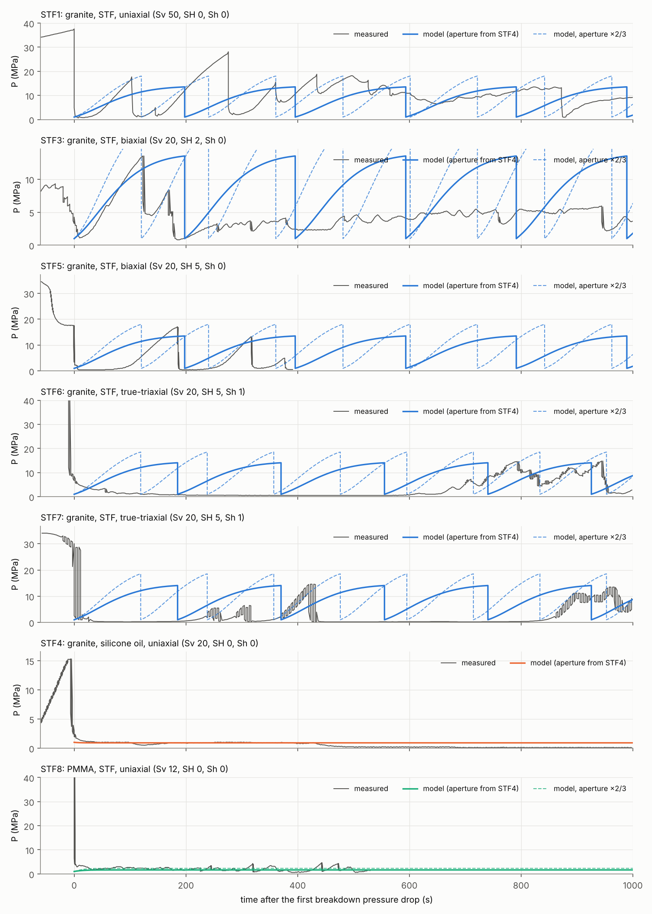
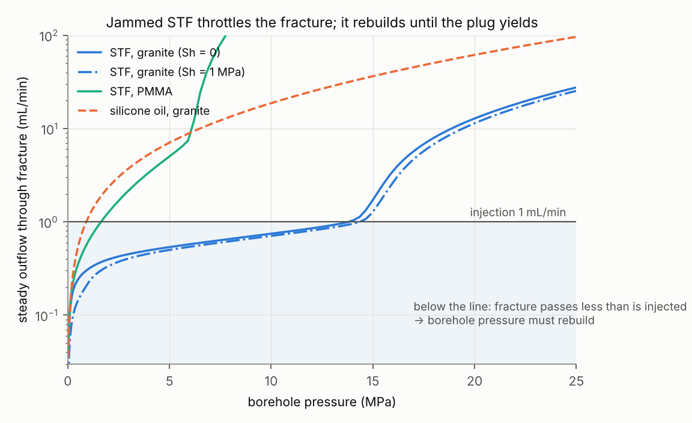
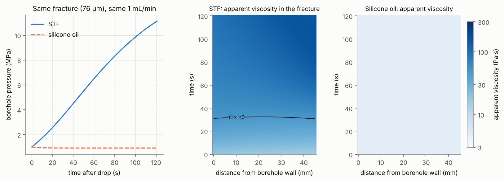
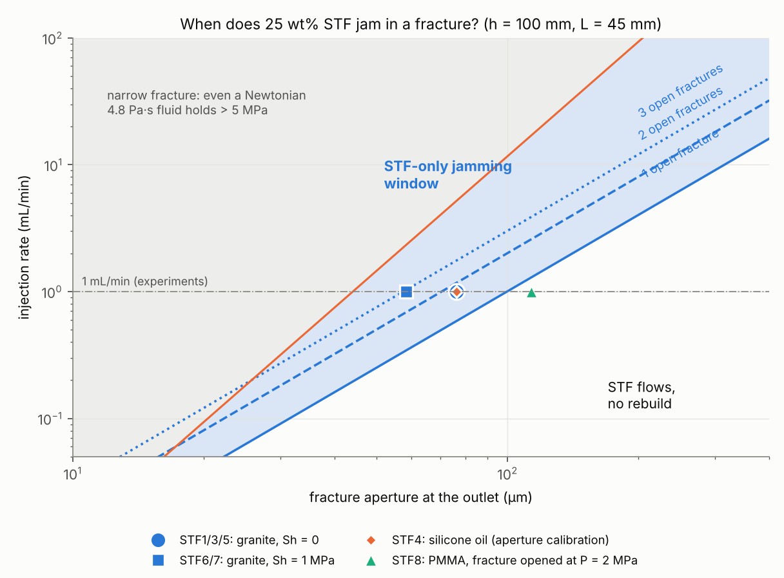

# Does the STF jam inside the fracture? — a simulation of pressure rebuild in STF fracturing

This folder holds a small, self-contained simulator (Python: NumPy/SciPy) that predicts whether a **shear-thickening fluid (STF) jams inside a hydraulic fracture** after breakdown. If it jams, the borehole pressure **rebuilds**, which gives multiple pressure drops and multidirectional fractures. If it doesn't jam, the fluid leaks off and the pressure stays low.

The two inputs you suggested are used directly:

* the **measured STF viscosity curve** (25 wt% fumed silica / ethylene glycol), and
* the **measured breakdown pressure**. The simulation starts from the state just after the first breakdown, so the breakdown pressure itself is not predicted.

It is tested against every experiment in Mukuhira et al. (2025): Table 1 plus the supplementary tests.

## Result

| Test | Specimen / fluid | Stress (MPa) | 1st BP (MPa) | Jamming number Π_J | Model: where the pressure levels off | **Model: STF jams & pressure rebuilds?** | Observed |
|---|---|---|---|---|---|---|---|
| STF1 | granite / STF | Sv 50 | 36.7 | 1.71 | 13.8 MPa, then the jammed plug is extruded | **yes** | yes (re-peaks 17.5, 28, 15.5, 18.5, 18) |
| STF3 | granite / STF | Sv 20, SH 2 | 22.0 | 1.71 | 13.8 MPa, then the jammed plug is extruded | **yes** | yes (9, 13.5, 8.5) |
| STF5 | granite / STF | Sv 20, SH 5 | 35.8 | 1.71 | 13.8 MPa, then the jammed plug is extruded | **yes** | yes (17, 13, 5) |
| STF6 | granite / STF | Sv 20, SH 5, Sh 1 | 45.0 | 2.91 | 14.4 MPa, then the jammed plug is extruded | **yes** | yes, after ~650 s delay (14.5, 15) |
| STF7 | granite / STF | Sv 20, SH 5, Sh 1 | 34.3 | 2.91 | 14.4 MPa, then the jammed plug is extruded | **yes** | yes, after ~250 s delay (5, 6.5, 14.5) |
| STF4 | granite / silicone oil (control) | Sv 20 | 15.0 | 0 (Newtonian) | 0.9 MPa (steady leak-off) | no | no |
| STF8 | **PMMA** / STF | Sv 12 | 60.4 | 1.71 | 1.6 MPa (fracture opens, STF leaks off) | no | no (only 3–4.5 MPa blips) |

**The rebuild yes/no is predicted correctly for 7 of 7 tests.** STF4 is the calibration case (see below), so the independent checks are the 5 granite STF tests and the PMMA test.



## Why the STF jams: the mechanism in one figure

After breakdown, a fracture connects the borehole to the specimen surface. At 1 mL/min, a fracture tens of µm wide forces the fluid through at wall shear rates of hundreds of 1/s. That is far above the rate at which this STF thickens (about 20–70 1/s, where viscosity rises ×50).

In pressure-driven flow the STF therefore cannot go faster than about 60–140 1/s: it jams, which is the measured flow curve in Fig. 1. The jammed STF can pass at most

```
Q_cap = n_f · h · (w²/2) · Φ(τ_max),   Φ(τ_w) = (1/τ_w²) ∫₀^τw τ·γ̇(τ) dτ     (generalized slot flow)
```

through the narrowest part of the fracture, which is the outlet where the pressure is lowest and the fracture most closed. Here w is the outlet aperture, h = 100 mm is the fracture height, n_f is the number of open fractures, and τ_max ≈ 15.6 kPa is the stress maximum of the measured curve, i.e. the strength of the jammed STF. The prediction then reduces to one number:

```
Π_J = Q_inj / Q_cap        Π_J > 1  →  the STF jams, the fracture throttles, the borehole pressure must rebuild
```

The pressure rises until the whole jammed column flows at its yield stress (plug extrusion, about 14 MPa here), then drops and rebuilds again. A Newtonian fluid of the same low-shear viscosity (silicone oil, 4.8 Pa·s) simply leaks off at a steady low pressure.



The fracture flow model also shows *where* the STF jams: within about 30 s the apparent viscosity in the whole fracture exceeds 10× its low-shear value, highest near the outlet. The silicone oil stays at 4.8 Pa·s.



Regime map. For 1 mL/min there is an **STF-only jamming window**, from about 43 µm to about 100 µm of outlet aperture for one open fracture. Narrower than that, even a viscous Newtonian fluid would hold pressure. Wider than that, the STF flows without jamming. The granite tests sit inside the window. In PMMA (E ≈ 3 GPa, 19× more compliant than granite) the fracture opens past the window at only about 1.5 MPa, which is why STF8 showed no rebuild.



## The model

1. **Rheology (`stf_jamming/rheology.py`)**: the digitized η(γ̇) of Fig. 1a, used as a table. No rheological model is assumed. The slot-flow law above is integrated exactly; in the Newtonian limit it reduces to the cubic law.
2. **Fracture (`stf_jamming/model.py`)**: 1D lubrication from the borehole wall to the specimen surface (L = 45 mm), with h = 100 mm. The aperture is that of a rough fracture closed by the normal stress on its plane (Barton–Bandis type, normal stress = Sh) plus elastic opening (π/2)L/E′ per MPa of net pressure, about 1.1 µm/MPa in granite and 18.5 µm/MPa in PMMA.
3. **Borehole/apparatus**: C(P)·dP/dt = Q_inj − Q_out, where C(P) is taken from the measured initial (no-leak) pressurization ramp (≈ 0.057 mL/MPa above 10 MPa).
4. **Two solvers**:
   * the transient 1D model, which gives the jamming front (Fig. 3);
   * a quasi-steady model, `stf_jamming/quasi_steady.py`, used for long histories with many cycles (Fig. 2) and for Q_out(P) (Fig. 4).

**The only calibrated number** is the fracture aperture. It was obtained from the silicone-oil control STF4: after breakdown the oil leaked off on a 0.91 MPa plateau, and with the cubic law that gives **w ≈ 76 µm**. The same aperture is then used, unchanged, to predict the STF tests.

## Limitations

* **The pressure drop itself is not modelled.** Breakdowns and re-fracturing are rock-fracture events. In the model a drop happens when the jammed plug yields, and the pressure is then reset to 1 MPa.
* **The yield stress is a lower bound.** The jammed STF strength is the unconfined rheometer value (15.6 kPa). STF squeezed in a fracture may be stronger, which fits the highest observed re-peaks (17–28 MPa) exceeding the model's ~14 MPa.
* **Rebuild rates for STF1, STF5 and STF7 are about 2× too slow** (model 0.11 vs observed 0.19–0.24 MPa/s at ~5 MPa). STF3 matches. The dashed lines in Fig. 2 (aperture ×2/3, about 51 µm) bracket the data. A narrower STF fracture is plausible, because silica residue was seen sealing fractures (paper Fig. 10).
* **The jamming margin is small.** The experiments sit at Π_J ≈ 1.7–2.9, and the outcome is sensitive to aperture and to the number of open fractures (`results/sensitivity.json`). With two equal open fractures, or a 33% wider aperture, the model predicts no jam. This is the most likely explanation of the **250–650 s delays in STF6/STF7**: after the most energetic breakdowns (34–45 MPa), more than one path was probably open and the STF jammed only once paths closed or clogged. The model does not include clogging kinetics.
* **Platen friction is not included.** In uniaxial tests the end-platen friction under Sv may clamp the fracture: larger Sv gives a narrower aperture, which gives easier jamming. That would fit the ARMA-2025 observation that multidirectional fracturing is favoured at high Sv. It is a hypothesis to test with Tokutake's data, not part of the model.

## Run it

```bash
pip install -r requirements.txt
python run_all.py          # ~40 s; writes results/*.png, predictions.json, predictions_table.md, sensitivity.json
```

## Add Tokutake's and your experiments

1. Append a row to `EXPERIMENTS` in `stf_jamming/experiments.py`. Give the stresses (Sv, SH, Sh), the first breakdown pressure, the specimen material, `observed_rebuild` (True/False) and, if you have it, a digitized P(t) CSV in `data/` (time_s, borehole_pressure_MPa). `tools/` contains the scripts used to digitize the published figures.
2. If the STF, the injection rate, or the specimen/borehole size differ, change the viscosity CSV, `GEOM["Q_inj"]`, `L` or `h`. If the apparatus differs, also change the compliance table in `default_compliance()`.
3. Run `python run_all.py` and compare the predicted rebuild (Π_J, plateau pressure) with what you observed.

## Next steps for fracture *patterns* (2D/3D)

This model predicts the pressure behaviour, i.e. jamming and rebuild. To predict the fracture pattern as well (how many fractures, which directions), the measured η(γ̇) or the jamming condition above can be put into:

* the lab's DEM (Wada et al., CouFrac 2024, based on Shimizu et al. 2011), or
* a cohesive-zone FEM with fluid flow along the fracture (e.g. Abaqus pore-pressure cohesive elements, user-defined viscosity), or
* a phase-field fracture code (FEniCS, MOOSE).

## Data source

All experimental data are digitized from the open-access article (CC BY-NC 4.0) and its supplementary material:
Mukuhira, Y., Goto, R., Watanabe, N., et al. (2025). *Creating multidirectional fractures through particle jamming.* International Journal of Rock Mechanics and Mining Sciences, 188, 106051. https://doi.org/10.1016/j.ijrmms.2025.106051
Digitized curves (`data/*.csv`) carry ±0.3 MPa / ±3 s reading error.
